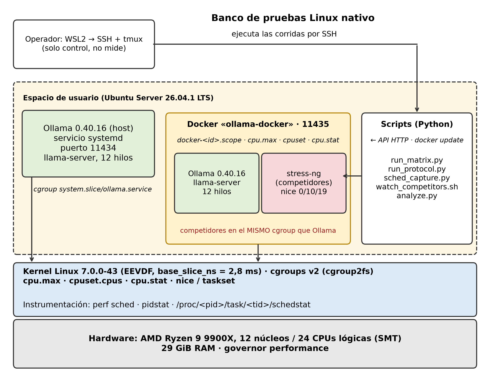
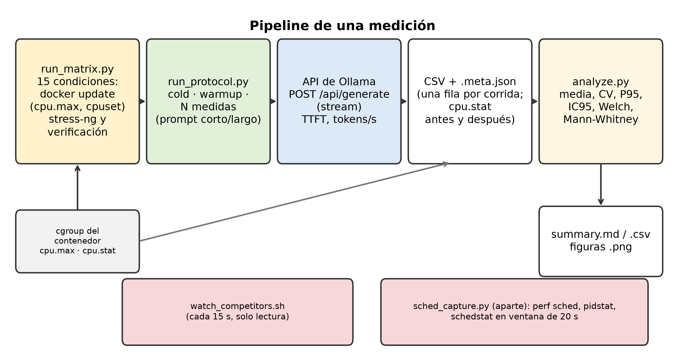

# 7. Implementación y desarrollo

Este capítulo documenta la realización del banco de pruebas; la justificación de las decisiones está en el capítulo 5. Los anexos B, C y D incluyen listados comentados de `run_protocol.py`, `run_matrix.py` y `analyze.py`, respectivamente.

## 7.1. Arquitectura del banco de pruebas

El banco es una PC dedicada con Linux nativo, a la que se accede por SSH desde WSL2 y donde las corridas se lanzan en `tmux`. WSL2 solo es terminal de control: nada se mide en él, por lo que no se compara Ollama de Windows contra Ollama en contenedor Linux.

La Figura 7.1 muestra las capas: hardware (AMD Ryzen 9 9900X, 12 núcleos y 24 CPUs lógicas con SMT, 29 GiB de RAM, governor `performance`); kernel Linux 7.0.0-43 con scheduler EEVDF y cgroups v2 (`cpu.max`, `cpuset.cpus`, `cpu.stat`, además de `nice` y `taskset`); y dos instancias de Ollama 0.40.16 solo CPU: un servicio de systemd en el host (puerto 11434) y el contenedor Docker `ollama-docker` (puerto 11435, publicado solo en loopback).



Cada instancia tiene su cgroup (`system.slice/ollama.service` el host, `system.slice/docker-<id>.scope` el contenedor). Los límites se aplican siempre al del contenedor, y los competidores `stress-ng` se incorporan **a ese mismo cgroup**: fuera de él competirían en otro nivel de la jerarquía y no necesariamente por la misma cuota.

### Scripts y flujo de datos

La Figura 7.2 resume el flujo de una medición.

- `run_matrix.py` define las 15 condiciones de los cuatro experimentos y, para cada una, configura el contenedor, lanza los competidores, invoca el protocolo y limpia.
- `run_protocol.py` fija el modelo (`llama3.2:3b`), los prompts (corto de 83 caracteres y largo de 2476) y los parámetros (`temperature 0`, `seed 1`, `num_predict 128`, `num_ctx 4096`). Por serie hace una corrida en frío (reportada aparte), un calentamiento por prompt y N corridas medidas intercaladas corto/largo, con transmisión (`/api/generate`) y TTFT medido en el cliente. Lee `cpu.stat` (`nr_throttled`, `throttled_usec`, `usage_usec`) antes y después de cada pedido.
- Cada serie produce un CSV (una fila por corrida) y un `.meta.json` con el entorno.
- `analyze.py` toma las filas `measured`, calcula las estadísticas y comparaciones por condición y prompt, y genera `summary.md` y las figuras.
- `sched_capture.py` captura aparte las métricas del scheduler (`perf sched`, `pidstat`, `schedstat`; ventana de 20 s) porque `perf` agrega carga; `watch_competitors.sh` es un vigilante de solo lectura que cada 15 s anota la condición y el estado de los competidores. Ninguno integra la cadena de medición.



## 7.2. Puesta en marcha paso a paso

**Paso 1. Sistema operativo y cgroups v2.** Se instaló Ubuntu Server 26.04.1 LTS y se registró el entorno en `experiments/env/environment.txt`:

```text
$ uname -r
7.0.0-43-generic

$ stat -fc %T /sys/fs/cgroup
cgroup2fs

$ cat /sys/fs/cgroup/cgroup.controllers
cpuset cpu io memory hugetlb pids rdma misc dmem
```

`cgroup2fs` confirma la jerarquía unificada (Docker informa `2/systemd`) y están los controladores `cpu` y `cpuset`.

**Paso 2. Scheduler.** El kernel 7.0 usa EEVDF, que reemplazó a CFS desde el 6.6 (The Linux Kernel documentation, s. f.-c). Lo prueba que `/sys/kernel/debug/sched/` expone `base_slice_ns`, no `min_granularity_ns` ni `latency_ns` de CFS:

```text
$ sudo cat /sys/kernel/debug/sched/base_slice_ns
2800000
```

El turno base es de 2,8 ms (se usa en el capítulo 8).

**Paso 3. Frecuencia.** Con SMT y boost activos, el governor es `performance` (el protocolo aborta si no lo es):

```text
$ cat /sys/devices/system/cpu/cpu0/cpufreq/scaling_governor
performance
```

**Paso 4. Herramientas.** Docker 29.10.0, Ollama 0.40.16 (host y contenedor), `perf` 7.0.14 (requiere `sudo`: `perf_event_paranoid` vale 4), `pidstat` (sysstat 12.7.7), `stress-ng` 0.20.01 y Python 3.14.4 con pandas, scipy y matplotlib.

**Paso 5. Dos instancias de Ollama.** El contenedor se publicó primero con `-p 11435:11434` (todas las interfaces) y se recreó solo en loopback. Antes de medir una instancia, el protocolo descarga el modelo de la otra y lo comprueba con `/api/ps`.

## 7.3. Cómo se aplican `cpu.max`, `cpuset` y `nice`

**Cuota.** Se aplica con `docker update --cpus N`, que escribe `cpu.max` del contenedor con período de 100 ms (2 CPUs equivalen a `200000 100000`). Quitarla requiere `--cpu-quota -1` (I2). `run_matrix.py` la quita, aplica la deseada y **lee `cpu.max` y `cpuset.cpus`** del cgroup; si difieren de lo esperado, aborta.

**Núcleos.** Los Exp 1 y 2 usan las 24 CPUs lógicas (`0-23`); los Exp 3 y 4, 12 CPUs lógicas (`6-11,18-23`): seis núcleos físicos con sus hermanas SMT, sin el núcleo 0 (incidencia I3).

**Competidores y `nice`.** `stress-ng` se lanza con una orden que escribe el PID de la shell en `cgroup.procs` del contenedor y hace `exec` de `nice -n <valor> taskset -c <cpuset> stress-ng --cpu <N> --cpu-method matrixprod`, y los trabajadores heredan cgroup, `nice` y afinidad. A los 3 s se verifica cada uno; si algo difiere, la condición falla. Con `nice` 0, 10 y 19 el kernel asigna pesos de 1024, 110 y 15 (Kerrisk, s. f.-e; Linux Kernel Developers, 2026).

**Evidencia de que comparten la CPU.** Un fragmento de `experiments/results/watch_competitors.csv` (hora, condición, trabajadores, `nice`, `cpu.max`, `cpuset`):

```text
09:43:30,exp3_comp1,1,0 ,max/100000,6-11,18-23
15:16:44,exp4_nice19,12,19 ,max/100000,6-11,18-23
```

El archivo tiene 2354 líneas (una cabecera y 2353 muestras); en todas, la cantidad y el `nice` fueron los esperados (1, 2, 3 y 12 competidores; `nice` 0, 10 y 19) y cero sin competencia. El throttling se lee de `cpu.stat`; en `exp2_cpus2` el contador crece en cada pedido:

```text
measured short rep=1   ttft=0.5081s tok/s=3.79 throttled=39332->39675
measured long  rep=1   ttft=6.7960s tok/s=3.59 throttled=39675->40100
```

## 7.4. Piloto, incidencias y lecciones

El piloto (N = 1 por condición) requirió tres intentos y un diagnóstico; las incidencias principales se resumen en la Tabla 7.1 y en los párrafos siguientes, y los logs de las fallas están en `experiments/pilot_failures/`.

**Tabla 7.1. Incidencias detectadas durante la prueba piloto y medidas adoptadas.**

| Incidencia | Qué pasó | Corrección o lección |
|---|---|---|
| I1 | `nr_throttled` daba siempre 0: el protocolo leía el cgroup del host, inactivo (el `.meta.json` apuntaba a `ollama.service`; el `cpu.stat` del contenedor mostraba `nr_throttled 2167`). | `run_matrix.py` pasa `--cgroup` y el protocolo aborta si no lee `cpu.stat`. CSV descartados. |
| I2 | El script abortó con `cpu.max is '200000 100000', expected 'max 100000'`: `docker update --cpus 0` no elimina la cuota previa en Docker 29. | La verificación de `cpu.max` evitó correr los Exp 3 y 4 con una cuota heredada. |
| I5 | En `exp3_comp6` (condición del piloto, ausente en la matriz final), dos corridas lentas y dos rápidas: un `Ctrl+C` a `tmux` alcanzó a los `stress-ng`, y el script los verificaba solo 3 s tras lanzarlos. | Vigilante de solo lectura para la corrida larga (Sección 7.3); código corregido después (Sección 7.6). |

Fuente: elaboración propia.

**Hilos de la aplicación y cuota (I3).** En el segundo intento, `exp3_comp0` (8 CPUs, sin competidores) llevaba más de 4 minutos en la corrida en frío, con `llama-server` en unos 810 % de CPU. El log del contenedor decía:

```text
llama threadpool init, n_threads = 12
```

Con 12 hilos de cómputo y 8 CPUs lógicas no podían ejecutarse todos a la vez. La demora de un hilo podría propagarse a otros en un punto de sincronización, pero el piloto no midió ese mecanismo. Para evitar esa sobresuscripción en la configuración, se fijaron los Exp 3 y 4 a 12 CPUs lógicas.

**Competencia catastrófica (I4).** En el tercer intento del piloto, `exp3_comp6` (6 competidores en 12 CPUs, condición que no quedó en la matriz final) cayó a 0,48 tokens/s contra unos 26 sin competencia. `experiments/diag_competition.py` midió el efecto (16 tokens por condición):

```text
competidores  tokens/s   frente a sin competencia
0             26.1       100 %
1             3.95       15 %
2             0.71       3 %
3             0.57       2 %
```

Una hipótesis es que el retraso de un hilo por la competencia podría demorar a los demás en una barrera de sincronización. El piloto midió la caída de rendimiento, no esa espera. Con N = 30, cada condición tardaría de 3 a 6 horas; por eso el diseño se ajustó (decisión de diseño del autor del 2026-11-19): Exp 3 con 0, 1, 2 y 3 competidores, y N = 10 en `exp3_comp2`, `exp3_comp3` y `exp4_nice0`; el resto mantiene N = 30.

**Caché de prompt (I6).** Con el prompt repetido, el TTFT del largo caía casi a cero por la caché KV; por eso cada pedido lleva un identificador único (`[request NNNN]`), igual en todas las condiciones. Efecto colateral: en 8 de cada 30 corridas del prompt largo el modelo cierra en 113 tokens en lugar de 128, siempre en las mismas repeticiones; no afecta las comparaciones porque tokens/s es por token.

El piloto corto de `exp3_comp1`, `exp4_nice10`, `exp4_nice19` y `exp4_nice19_cpus2` (N = 1) salió limpio, con `prompt_eval_count` de 47 y 516 y `eval_count` de 128 en todas las corridas, y el protocolo se dio por validado. Esos valores (N = 1) son orientativos y no integran los resultados.

## 7.5. La corrida completa

La corrida se lanzó el 2026-11-19 a las 06:55 (UTC, hora del servidor) y terminó a las 17:09 UTC (10 h 15 min). Ejecutó las 15 condiciones, con N = 30 en 12 y N = 10 en 3: 12 × 30 × 2 + 3 × 10 × 2 = 780 corridas medidas (dos prompts por repetición). El final de `experiments/results/night.log`:

```text
measured long  rep=30  ttft=9.1991s tok/s=2.82 throttled=173221->173767
wrote .../exp4_nice19_cpus2_20261119-152350.csv
end exp4_nice19_cpus2 17:09:51 temp=44.375C

container restored to no limits
all 15 conditions finished
EXIT=0
```

La verificación mostró 15 de 15 condiciones, cero reintentos (ningún `retrying`), cero fallas y salida 0; el contenedor quedó sin límites (`max 100000`, `0-23`) y sin `stress-ng`. La carga en frío, aparte, fue de 1,0 a 6,9 s, salvo `exp4_nice19_cpus2` con 38,8 s (2 CPUs y 12 competidores).

Después, `sched_capture.py` capturó las métricas del scheduler (O4) en 10 condiciones: las 8 de la primera captura (`exp2_nolimit`, `exp2_cpus4`, `exp2_cpus1`, `exp3_comp0`, `exp3_comp1`, `exp4_nice10`, `exp4_nice19`, `exp4_nice19_cpus2`) y 2 sugeridas en una revisión técnica posterior (`exp2_cpus2`, `exp4_nice0`), comprobando al cerrar cada ventana de 20 s que los competidores siguieran vivos. Su análisis está en el capítulo 8.

Dos incidencias del análisis se trataron sin modificar los datos crudos: el redondeo a 2 decimales de tokens/s ocultaba la variabilidad de `exp4_nice0` (coeficiente de variación real, recalculado con `eval_count / eval_s`: 0,13 %) (I7), y 3 de 60 corridas de `exp4_nice19_cpus2` tardaron 102 s, 600 s y 1261 s frente a unos 45 s habituales (I8). Son válidas y se reportan como resultado (capítulo 8).

## 7.6. Correcciones posteriores a la revisión técnica y su validación

Una revisión técnica independiente del 2026-11-19 aprobó el entorno y el protocolo con observaciones; esas advertencias sobre el código no se corrigieron durante la corrida, y los scripts originales quedaron guardados en el servidor. Después se corrigieron `run_protocol.py` y `run_matrix.py`:

- los competidores se verifican también al **final** de cada condición, que falla si faltan;
- un reintento usa un número de pedido nuevo y registra la columna `attempt`, para que la caché no falsee el TTFT;
- se verifica el estado HTTP 200 de cada pedido y que `unload()` descargue el modelo;
- `cpu.max`, `cpuset`, competidores y `nice` se guardan en el `.meta.json`;
- la limpieza espera (`wait()`) a `stress-ng`, mata solo los de su cgroup y restaura el contenedor aunque falle;
- tokens/s se guarda con 4 decimales y el CSV se graba fila por fila.

La validación fue un piloto de N = 1 con el código corregido (`experiments/pilot_fixed_code/`) sobre `exp1_host` y `exp3_comp1`; esta última terminó con la comprobación nueva:

```text
end exp3_comp1 18:38:53 temp=60.375C competitors_alive=1/1

container restored to no limits
all 2 conditions finished
EXIT=0
```

Los datos del informe provienen de la corrida original, con los scripts previos a la corrección; por eso en ella los competidores se verificaron con el vigilante. Las pruebas de la lógica de configuración siguen siendo manuales (no hay tests automáticos), lo que se declara como limitación.
