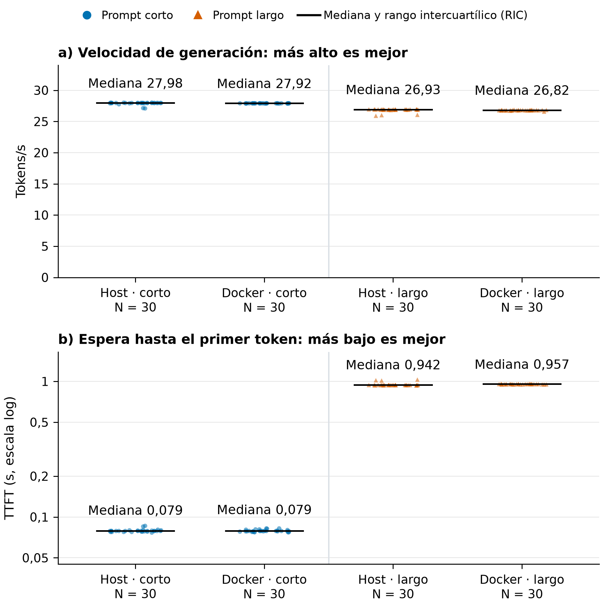
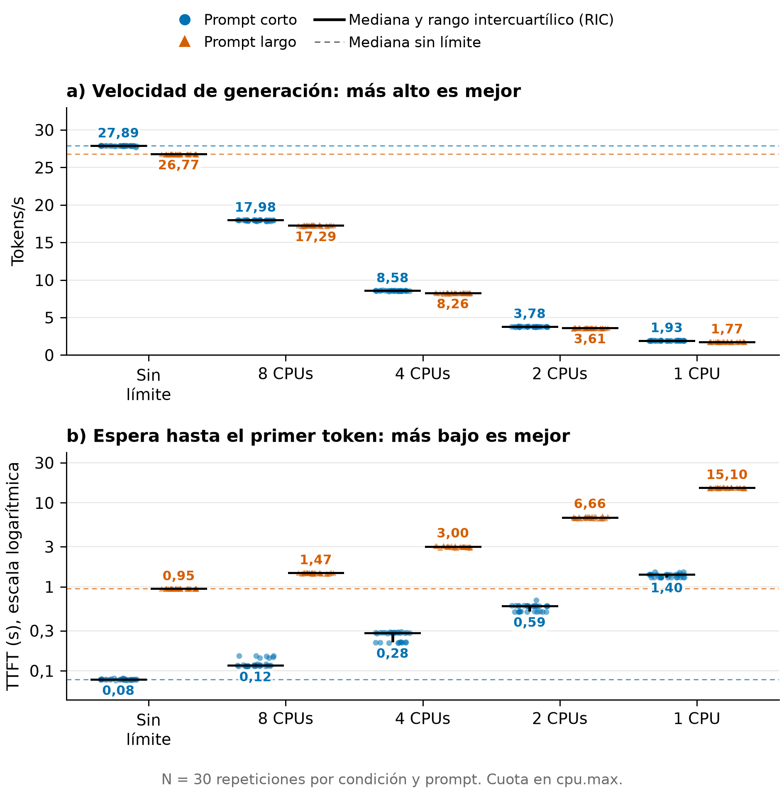

# 8. Resultados y análisis

Las secciones 8.2 a 8.5 presentan un objetivo cada una; la 8.6 contrasta las hipótesis y las 8.7 a 8.9 discuten límites, alternativas y mejoras. Las cifras provienen de `experiments/analysis/summary.md`, `experiments/analysis/summary.csv`, `experiments/analysis/comparisons.csv`, `experiments/sched/summary.csv` y `experiments/sched_extra/summary.csv`.

## 8.1. Convenciones de lectura

**Entorno.** Las condiciones de medición (Linux nativo, kernel, scheduler EEVDF, cgroups v2, hardware, modelo y parámetros de inferencia) están descritas en el capítulo 5.

**Redondeo.** Se reproducen las cifras de `summary.md`. *Throttled* se expresa en segundos por corrida (`throttled_usec` de `cpu.stat`, sumado sobre las CPUs del cgroup, por lo que puede superar la duración de la corrida); «Throttles por corrida» es `nr_throttled`.

**Tamaño de muestra.** Cada condición tiene N = 30 repeticiones por prompt, salvo `exp3_comp2`, `exp3_comp3` y `exp4_nice0`, con **N = 10** (marcadas con †; decisión de diseño del trabajo, 2026-11-19). En ellas el **P95 es orientativo**, pues con diez muestras es casi el máximo; la media y el CV sí son interpretables. «Corto» designa el prompt de unos 47 tokens y «largo» el de 516.

**Estadística.** Se informa la diferencia porcentual, el delta de Cliff (Cliff, 1993) y el valor *p* de Welch (1947) con ajuste de Holm-Bonferroni (Holm, 1979); con CV tan bajos se privilegia el tamaño del efecto sobre la significancia.

## 8.2. Objetivo O1: Ollama en el host frente a Ollama en Docker

**Objetivo O1.** «Comparar Ollama ejecutado directamente en Linux y dentro de Docker, sin límites adicionales de CPU.»

**Tabla 8.1. Ollama en el host y en Docker, sin límites (24 CPUs disponibles).**

| Condición | Prompt | N | TTFT media (s) | TTFT P95 (s) | TTFT CV | tokens/s media | tokens/s P95 | tokens/s CV |
|---|---|---|---|---|---|---|---|---|
| Host | corto | 30 | 0,079 | 0,083 | 2,5 % | 27,91 | 28,01 | 0,8 % |
| Host | largo | 30 | 0,950 | 1,019 | 2,7 % | 26,84 | 26,98 | 1,0 % |
| Docker | corto | 30 | 0,079 | 0,082 | 1,8 % | 27,92 | 27,95 | 0,1 % |
| Docker | largo | 30 | 0,957 | 0,961 | 0,3 % | 26,81 | 26,87 | 0,2 % |

Fuente: `experiments/analysis/summary.md` (sección `exp1`). En las cuatro condiciones el throttling es 0 y la carga en frío del modelo es de 1,03 s.

**Cómo leer la Figura 8.1.** El panel A muestra cuántos tokens se generan por segundo; el panel B, cuántos segundos pasan hasta que aparece el primero (TTFT, escala logarítmica). La comparación se hace entre host y Docker dentro de cada tipo de prompt. Cada punto es una corrida; el trazo negro marca la mediana y el rango intercuartílico. Los números rotulados son medianas; las tablas informan medias, que difieren levemente donde hay corridas atípicas.

**Efecto y significancia.** Docker difiere del host en −0,1 % y +0,7 % (TTFT corto y largo) y en +0,0 % y −0,1 % (tokens/s). Welch no detecta diferencia (p sin ajustar = 0,83 y 0,15 en TTFT; 0,86 y 0,55 en tokens/s; con el ajuste de Holm, p = 1,0 en tres de las cuatro comparaciones y 0,61 en TTFT largo). Mann-Whitney sí en tokens/s (p Holm = 6,1e-06 y 4e-06) y TTFT largo (2,5e-06), con deltas de Cliff de −0,77, −0,79 y +0,80: con CV inferior a 3 %, el test de rangos detecta ordenamientos de centésimas de token por segundo sin consecuencia práctica.

**Interpretación.** Un contenedor no virtualiza la CPU: son procesos del mismo kernel aislados con namespaces y limitados con cgroups, por lo que sin límites la ausencia de sobrecosto es lo esperado; su costo aparece en otras capas (red, disco, arranque) que esta medición no ejercita. La única diferencia es de variabilidad: P95 de TTFT largo de 1,019 s en el host frente a 0,961 s en Docker (CV 2,7 % frente a 0,3 %), atribuible a unas pocas corridas lentas cuya causa no se investigó. La equivalencia justifica usar el contenedor, donde `docker update` permite imponer cuotas.

## 8.3. Objetivo O2: límites de CPU mediante cgroups v2

**Objetivo O2.** «Evaluar distintos límites de CPU mediante cgroups v2, midiendo TTFT, tokens por segundo y latencia P95.»

**Tabla 8.2. Efecto de la cuota de CPU (`cpu.max`) sobre la inferencia.**

| Condición | Prompt | N | TTFT media (s) | TTFT P95 (s) | TTFT CV | tokens/s media | tokens/s P95 | tokens/s CV | Throttles por corrida | Throttled por corrida (s) |
|---|---|---|---|---|---|---|---|---|---|---|
| Sin límite | corto | 30 | 0,079 | 0,081 | 1,3 % | 27,88 | 27,90 | 0,1 % | 0 | 0,0 |
| Sin límite | largo | 30 | 0,952 | 0,954 | 0,2 % | 26,78 | 26,82 | 0,1 % | 0 | 0,0 |
| 8 CPUs | corto | 30 | 0,123 | 0,151 | 11,3 % | 17,95 | 18,02 | 0,3 % | 72 | 29,1 |
| 8 CPUs | largo | 30 | 1,463 | 1,481 | 1,2 % | 17,28 | 17,36 | 0,3 % | 86 | 34,6 |
| 4 CPUs | corto | 30 | 0,262 | 0,289 | 12,5 % | 8,57 | 8,60 | 0,4 % | 152 | 121,7 |
| 4 CPUs | largo | 30 | 3,005 | 3,081 | 1,6 % | 8,26 | 8,31 | 0,5 % | 180 | 144,1 |
| 2 CPUs | corto | 30 | 0,565 | 0,598 | 8,6 % | 3,78 | 3,84 | 0,8 % | 344 | 344,1 |
| 2 CPUs | largo | 30 | 6,710 | 6,902 | 2,3 % | 3,61 | 3,64 | 0,8 % | 411 | 410,8 |
| 1 CPU | corto | 30 | 1,362 | 1,496 | 4,9 % | 1,93 | 1,96 | 0,9 % | 677 | 744,9 |
| 1 CPU | largo | 30 | 15,125 | 15,354 | 0,9 % | 1,77 | 1,78 | 0,6 % | 853 | 938,0 |

Fuente: `experiments/analysis/summary.md` (sección `exp2`). La carga en frío del modelo fue de 1,11 s (sin límite y 8 CPUs), 1,40 s (4), 1,70 s (2) y 2,70 s (1).

**Cómo leer la Figura 8.2.** Arriba se ve cuánto cae la velocidad de generación al reducir la cuota de CPU; abajo, cuánto aumenta la espera hasta el primer token. Las líneas punteadas marcan las medianas sin límite para cada prompt. Cada eje vertical tiene su propia unidad y el de abajo usa escala logarítmica.

**Efecto y significancia.** Todas las comparaciones contra «sin límite» tienen delta de Cliff = ±1,00 y p Holm (Welch) inferior a 1e-15. En tokens/s, la caída es de −35,6 % / −35,5 % (8 CPUs, corto / largo), −69,3 % / −69,1 % (4), −86,4 % / −86,5 % (2) y −93,1 % / −93,4 % (1). El TTFT crece +55,6 % / +53,7 % (8), +231,7 % / +215,8 % (4), +614,7 % / +605,1 % (2) y +1623,1 % / +1489,4 % (1): el TTFT largo, de 0,952 s a 1,463, 3,005, 6,710 y 15,125 s, aproximadamente se duplica cada vez que la cuota se reduce a la mitad.

**Interpretación.** La cuota se cumple de forma exacta: el cgroup consumió 8,00, 4,00, 2,00 y 1,00 CPUs, frente a 12,01 sin límite. `cpu.max` concede un presupuesto por período de 100 ms y, al agotarlo, frena a todas las tareas del cgroup hasta el período siguiente (con 4, 2 y 1 CPUs, 10 throttles por segundo; sección 8.5).

La caída es además algo **peor que proporcional**: el rendimiento por CPU usada (largo) baja de 2,23 tokens/s sin límite a 2,16, 2,07, 1,80 y 1,77. **Hipótesis:** los 12 hilos de llama.cpp se sincronizan en cada paso, así que cuando el throttling frena a uno, los demás esperan y pierden su porción de cuota. Es coherente con los datos, pero no se aisló variando el número de hilos.

La variabilidad de tokens/s es baja (CV < 1 %). El CV del TTFT corto es mayor con 8 y 4 CPUs (11,3 % y 12,5 %), probablemente porque el prompt dura decenas de milisegundos y el corte de un período de 100 ms cae o no dentro de él (hipótesis no verificada).

## 8.4. Objetivo O3: competencia con stress-ng y valores de nice

**Objetivo O3.** «Analizar el efecto de procesos competidores con stress-ng y diferentes valores de nice.»

En los Exp 3 y 4 Ollama se fijó a 12 CPUs lógicas (`6-11,18-23`) y los `stress-ng` se ubicaron en esas CPUs **dentro del mismo cgroup**, de modo que compiten realmente y el reparto lo determina `nice`; un vigilante confirmó cada 15 s que seguían vivos con el `nice` esperado. Como esa base (12 CPUs, SMT) rinde menos (23,74 tokens/s, largo) que la de los Exp 1 y 2 (26,78), se compara siempre dentro de cada experimento.

### 8.4.1. Número de competidores (Exp 3)

**Tabla 8.3. Efecto del número de competidores de igual prioridad (nice 0).**

| Condición | Prompt | N | TTFT media (s) | TTFT P95 (s) | TTFT CV | tokens/s media | tokens/s P95 | tokens/s CV |
|---|---|---|---|---|---|---|---|---|
| 0 competidores | corto | 30 | 0,106 | 0,109 | 2,7 % | 24,52 | 24,54 | 0,0 % |
| 0 competidores | largo | 30 | 1,381 | 1,383 | 0,1 % | 23,74 | 23,77 | 0,1 % |
| 1 competidor | corto | 30 | 0,849 | 1,699 | 62,9 % | 2,54 | 2,95 | 10,3 % |
| 1 competidor | largo | 30 | 2,790 | 2,975 | 4,5 % | 2,45 | 2,90 | 10,1 % |
| 2 competidores | corto | 10† | 1,483 | 2,142 | 49,4 % | 0,75 | 0,80 | 5,1 % |
| 2 competidores | largo | 10† | 3,156 | 3,225 | 2,4 % | 0,74 | 0,83 | 7,5 % |
| 3 competidores | corto | 10† | 1,995 | 2,149 | 17,5 % | 0,54 | 0,57 | 3,7 % |
| 3 competidores | largo | 10† | 3,319 | 3,397 | 1,6 % | 0,53 | 0,54 | 1,7 % |

† N = 10: el P95 es orientativo. Fuente: `experiments/analysis/summary.md` (sección `exp3`). Throttling = 0 en todas las condiciones (no hay cuota).

**Efecto y significancia.** Todas las comparaciones contra 0 competidores tienen delta de Cliff = ±1,00 y p Holm (Welch) ≤ 0,0011 (el mayor, en TTFT corto con 2 competidores). Los tokens/s caen −89,7 %, −96,9 % y −97,8 % con 1, 2 y 3 competidores (idénticos en corto y largo). El TTFT crece +700,6 % (corto) y +102,1 % (largo) con 1 competidor; +1298,2 % y +128,5 % con 2; +1780,7 % y +140,3 % con 3.

**Variabilidad.** El CV de tokens/s pasa de 0,1 % (0,0 % en el corto) a 10,1 % y 10,3 % con un competidor; el del TTFT corto, de 2,7 % a 62,9 % (media 0,849 s, P95 1,699 s).

**Interpretación.** Con un competidor los hilos esperan en cola solo 7,7 % del tiempo (0,92 CPUs de 12; demora media 2,49 ms, máxima 5,0 ms, del orden de un turno de EEVDF de 2,8 ms) y aun así el rendimiento cae 90 %. **Hipótesis:** en cada paso los 12 hilos esperan al más lento, y uno que comparte CPU con un competidor frena a los otros 11; la métrica de cola promedia por hilo y subestima ese costo.

### 8.4.2. Prioridad con nice (Exp 4)

En el Exp 4 hay 12 competidores y se varía el `nice` **de los competidores** (Ollama queda en nice 0), más un caso con nice 19 y cuota de 2 CPUs.

En las columnas TTFT y tokens/s, los valores se leen en este orden: media / P95 / coeficiente de variación (CV, en %). «Throttles» y «Throttled (s)» son valores por corrida, con el mismo significado que «Throttles por corrida» y «Throttled por corrida (s)» en la Tabla 8.2.

**Tabla 8.4. Efecto del nice de los competidores (12 `stress-ng`), con y sin cuota.**

| Condición | Prompt | N | TTFT (s / s / %) | tokens/s (t/s / t/s / %) | Throttles | Throttled (s) |
|---|---|---|---|---|---|---|
| nice 0 | corto | 10† | 2,196 / 2,243 / 1,4 | 0,47 / 0,47 / 0,1 | 0 | 0,0 |
| nice 0 | largo | 10† | 4,210 / 4,298 / 1,3 | 0,47 / 0,47 / 0,1 | 0 | 0,0 |
| nice 10 | corto | 30 | 0,271 / 0,435 / 32,7 | 10,19 / 14,89 / 25,6 | 0 | 0,0 |
| nice 10 | largo | 30 | 2,142 / 2,440 / 8,6 | 9,53 / 13,23 / 21,5 | 0 | 0,0 |
| nice 19 | corto | 30 | 0,122 / 0,130 / 5,1 | 21,32 / 21,72 / 1,0 | 0 | 0,0 |
| nice 19 | largo | 30 | 1,506 / 1,529 / 0,9 | 20,59 / 20,84 / 0,9 | 0 | 0,0 |
| nice 19 + 2 CPUs | corto | 30 | 0,838 / 0,899 / 6,9 | 2,89 / 3,07 / 21,4 | 854 | 854,1 |
| nice 19 + 2 CPUs | largo | 30 | 9,392 / 9,400 / 6,9 | 2,83 / 2,99 / 17,7 | 703 | 702,7 |

† N = 10: el P95 es orientativo. Fuente: `experiments/analysis/summary.md` (sección `exp4`). La carga en frío fue de 6,89 s (nice 0), 2,45 s (nice 10), 2,50 s (nice 19) y 38,80 s (nice 19 + 2 CPUs).

**Efecto y significancia.** Respecto de nice 0, nice 10 mejora tokens/s +2054,1 % (corto) y +1913,5 % (largo) y reduce el TTFT −87,6 % y −49,1 %; nice 19 mejora tokens/s +4406,7 % y +4251,5 % y reduce el TTFT −94,5 % y −64,2 %; todos con delta de Cliff = ±1,00 y p Holm (Welch) ≤ 2,8e-16. Aun con nice 19, Ollama no iguala la ejecución sin competencia (`exp3_comp0`): tokens/s −13,1 % y −13,3 %, TTFT +14,7 % y +9,1 % (delta de Cliff +0,99 y +1,00; −1,00 en ambos tokens/s). Al agregar la cuota de 2 CPUs a nice 19, tokens/s cae −86,4 % y −86,3 % frente a nice 19 sin cuota, y el TTFT crece +588,8 % y +523,6 %.

**Interpretación del nice.** Los pesos del kernel para nice 0, 10 y 19 son 1024, 110 y 15 (Kerrisk, s. f.-e; Linux Kernel Developers, 2026); frente a 12 competidores, la porción teórica de Ollama sería 50 %, 90 % y 98,6 %, y las capturas concuerdan (6,00, 10,78 y 11,82 de 12 CPUs). El rendimiento, en cambio, es mucho menor: 0,47 tokens/s con nice 0 (2 % de la base) pese a la mitad de la CPU, y 9,53 con nice 10 (cerca de 40 %) con el 90 %. Es coherente con la hipótesis de sincronización. Con nice 0 hay además 1994 cambios de contexto involuntarios por segundo, contra 19,9 y 229,5 sin competencia ni cuota: un scheduler justo no garantiza buen rendimiento a hilos fuertemente acoplados.

**La cuota estricta.** Con nice 19 y cuota de 2 CPUs, Ollama rinde 2,83 tokens/s (largo), menos que con la misma cuota sin competidores (3,61, Tabla 8.2). Ollama corre 1,33 CPUs y los competidores, **pese a nice 19**, se llevan 0,67 de las 2 CPUs: el límite se aplica al cgroup completo y la prioridad solo reparte lo que queda dentro.

**Episodios de bloqueo.** En esta condición, 3 de las 60 corridas tardaron muchísimo más que una normal (~45 s): 102 s (corto, rep 8; 1,27 tokens/s), 600 s (largo, rep 15; 0,19) y 1261 s (corto, rep 18; 0,10). Arrastran la media (2,83 y 2,89 tokens/s) por debajo de la mediana (2,93 y 3,05) y explican el CV elevado (17,7 % y 21,4 %); por eso la mediana es más representativa. **Hipótesis:** los hilos esperan «girando», gastando el presupuesto sin avanzar cuando la cuota frena al hilo del que dependen. **La causa no está demostrada**: la captura posterior del scheduler (ventana separada de 20 s, sin generaciones completadas) no registró los episodios originales.

## 8.5. Objetivo O4: relación con el throttling y las métricas del scheduler

**Objetivo O4.** «Relacionar los resultados con el throttling registrado en cpu.stat y las métricas del scheduler.»

Las métricas (`schedstat` por hilo, `perf sched`, `pidstat`, `cpu.stat`) se capturaron en una corrida **aparte**, porque `perf` contaminaría las latencias: 20 s de generación continua con el prompt largo en 10 condiciones (8 en `experiments/sched/` y 2 en `experiments/sched_extra/`).

**Tabla 8.5. Métricas del scheduler por condición (ventana de 20 s, prompt largo).**

| Condición | CPUs de Ollama corriendo | CPUs esperando en cola | % del tiempo esperando | Demora media / máx. (ms) | Cambios de contexto involuntarios/s | Throttles/s | CPU de los competidores | tokens/s (corrida completa) |
|---|---|---|---|---|---|---|---|---|
| Exp 2 sin límite | 12,00 | 0,00 | 0,0 % | 0,01 / 1,0 | 19,9 | 0,0 | 0,00 | 26,78 |
| Exp 2, 4 CPUs | 4,00 | 8,00 | 66,7 % | 47,91 / 71,5 | 133,8 | 10,0 | 0,00 | 8,26 |
| Exp 2, 2 CPUs | 2,00 | 10,00 | 83,4 % | 69,05 / 88,5 | 132,1 | 10,0 | 0,00 | 3,61 |
| Exp 2, 1 CPU | 1,00 | 11,00 | 91,7 % | 71,85 / 94,6 | 145,4 | 10,0 | 0,00 | 1,77 |
| Exp 3, 0 competidores | 11,99 | 0,01 | 0,1 % | 0,05 / 4,0 | 229,5 | 0,0 | 0,00 | 23,74 |
| Exp 3, 1 competidor | 11,08 | 0,92 | 7,7 % | 2,49 / 5,0 | 361,8 | 0,0 | 0,91 | 2,45 |
| Exp 4, nice 0 | 6,00 | 6,00 | 50,0 % | 3,00 / 11,0 | 1994,4 | 0,0 | 6,00 | 0,47 |
| Exp 4, nice 10 | 10,78 | 1,22 | 10,2 % | 2,14 / 4,0 | 542,1 | 0,0 | 1,22 | 9,53 |
| Exp 4, nice 19 | 11,82 | 0,18 | 1,5 % | 0,52 / 4,8 | 269,6 | 0,0 | 0,17 | 20,59 |
| Exp 4, nice 19 + 2 CPUs | 1,33 | 10,67 | 88,9 % | 32,63 / 90,0 | 311,2 | 10,0 | 0,67 | 2,83 |

Fuente: `experiments/sched/summary.csv` y `experiments/sched_extra/summary.csv` (las filas «Exp 2, 2 CPUs» y «Exp 4, nice 0» provienen de `sched_extra`). La CPU de los competidores es el tiempo de CPU de `stress-ng` medido por `perf` dividido por la ventana. La última columna proviene de `summary.md`, no de la ventana. Las cifras son las de `summary.csv` redondeadas a la precisión mostrada.

Las capturas aportan tres lecturas. **(1) Cuota:** Ollama corre exactamente con la cuota y espera el resto; la demora máxima (71,5 a 94,6 ms) llega casi a un período de 100 ms, con un throttle por período: el mecanismo de H1 visto desde el scheduler. **(2) Competencia sin cuota:** el throttling es 0 y el costo viene de la espera en cola y la sincronización de hilos. **(3) Prioridad:** la espera y la CPU de los competidores siguen los pesos de nice, pero con cuota estricta recuperan 0,67 CPUs pese a nice 19.

Cautela: las ventanas son independientes de la corrida medida y en varias condiciones completaron pocas generaciones (6 en `exp2_nolimit` y `exp3_comp0`; 5 en nice 19; 3 en nice 10; 2 en 4 CPUs; 1 en 1 CPU, 2 CPUs, 1 competidor y nice 0; 0 en nice 19 + 2 CPUs). No se miden sobre las mismas corridas que el rendimiento.

## 8.6. Contraste con las hipótesis

**Tabla 8.6. Hipótesis y evidencia.**

| Hipótesis (texto de la sección 3.3) | Veredicto | Evidencia principal |
|---|---|---|
| H1: «La reducción de la cuota de CPU incrementa la latencia y disminuye el rendimiento de inferencia cuando se produce throttling.» | Se confirma | tokens/s −35,6 %, −69,3 %, −86,4 % y −93,1 % (corto) con 8, 4, 2 y 1 CPUs; TTFT largo 0,952 a 15,125 s; throttling de 86 a 853 por corrida (largo) |
| H2: «La competencia por CPU incrementa la latencia y su variabilidad respecto de una ejecución sin competencia.» | Se confirma, con un efecto mayor al esperado | tokens/s −89,7 %, −96,9 % y −97,8 %; CV de tokens/s de 0,1 % a 10,1 % (largo); CV del TTFT corto de 2,7 % a 62,9 % |
| H3: «Ajustar la prioridad mediante nice puede reducir la interferencia de procesos competidores, pero no necesariamente compensar las limitaciones impuestas por una cuota estricta de CPU.» | Se confirma en sus dos partes | nice 0 → 19: 0,47 → 20,59 tokens/s (largo); nice 19 + 2 CPUs: 2,83 tokens/s, con 703 throttles por corrida |

Fuente: elaboración propia a partir de `experiments/analysis/summary.md` y `experiments/analysis/comparisons.csv`.

**H1.** Se confirma: hay throttling en todas las condiciones con cuota (72 a 853 por corrida) y el efecto es regular (CV < 1 %) y algo mayor que proporcional (de 2,23 a 1,77 tokens/s por CPU).

**H2.** Se confirma, con un efecto mayor al sugerido: un colapso de 90 % con un solo competidor. La variabilidad aumenta respecto de la base pero no de forma monótona: con 2 y 3 competidores el CV de tokens/s (5,1 % a 7,5 % y 1,7 % a 3,7 %) es menor que con 1 (10,1 % y 10,3 %), y esas condiciones tienen N = 10.

**H3.** Se confirma en sus dos partes: con nice 19 Ollama recupera 87 % del rendimiento sin competencia (20,59 frente a 23,74 tokens/s, largo), pero bajo cuota de 2 CPUs rinde 2,83, menos que con la cuota sin competidores (3,61). La segunda parte no depende de los episodios de bloqueo: se cumple tanto con la media (2,83 tokens/s) como con la mediana (2,93), ambas por debajo de 3,61.

## 8.7. Limitaciones

- **Una máquina, un modelo, una configuración de hilos.** Ryzen 9 9900X con SMT, `llama3.2:3b` (Q4) y Ollama con 12 hilos: los valores absolutos no son extrapolables a otras CPU, modelos o motores. Solo CPU, por decisión de alcance.
- **N = 10 en tres condiciones.** `exp3_comp2`, `exp3_comp3` y `exp4_nice0`: su P95 y P5 son orientativos.
- **I6: 113 tokens en lugar de 128.** En el prompt largo, 8 de cada 30 respuestas (2 de 10 con N = 10) terminan en 113 tokens, siempre en las mismas corridas. No afecta las comparaciones: tokens/s es por token y el TTFT no depende del largo de salida.
- **I8: episodios de bloqueo.** Los tres episodios de `exp4_nice19_cpus2` son datos válidos y se mantienen; su causa no está demostrada.
- **Capturas del scheduler en ventanas separadas** y con pocas generaciones: evidencia de mecanismo, no medición simultánea. No se varió el número de hilos ni se probó otro scheduler, por lo que atribuir el colapso a la sincronización por paso es una inferencia, no un resultado experimental.
- **`cpu.stat` mezcla procesos en Exp 3 y 4.** «CPUs usadas» (12,00) no separa Ollama de `stress-ng`; para eso se usan las capturas de 8.5.

## 8.8. Qué habría cambiado con otro enfoque

- **Competidores en un cgroup hermano con `cpu.weight`.** Poner los competidores en el cgroup de Ollama fue necesario para que compitieran, pero es un escenario menos habitual que el de contenedores vecinos; con cgroups hermanos se medirían políticas de aislamiento multi-inquilino y la interferencia probablemente sería distinta (conjetura no medida).
- **Fijar el número de hilos de Ollama** (8 en 8 CPUs en lugar de 12 en 12) habría evitado la sobresuscripción de hilos del piloto (I3; Jeffery et al., 2024) y aislado el efecto de la sincronización.
- **N = 30 en todas las condiciones** habría dado P95 interpretables en las tres excepciones.

## 8.9. Mejoras para trabajo futuro

1. **Medir los episodios de bloqueo con instrumentación continua.** Repetir `exp4_nice19_cpus2` con N mayor y registrar `schedstat` por hilo y `cpu.stat` cada segundo, sin `perf`, para capturar un episodio cuando ocurre y comprobar o descartar la espera activa. Se justifica porque la causa de I8 es la principal incógnita y el registro liviano evita el sesgo de `perf`.
2. **Variar el número de hilos de Ollama** (4, 8 y 12) frente a la cuota y los competidores. Si el colapso se debe a la sincronización por paso, debería disminuir con menos hilos: es una prueba directa de la hipótesis de las secciones 8.3 y 8.4. Después podrían compararse `cpu.weight` entre cgroups hermanos y, como extensión opcional, SCHED_FIFO y SCHED_RR (Kerrisk, s. f.-e; The Linux Kernel documentation, s. f.-b, s. f.-d).
